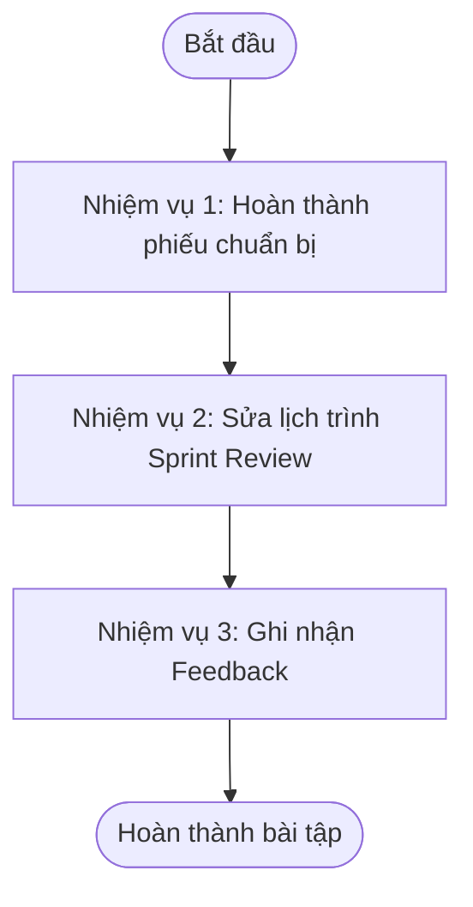

# BÀI THỰC HÀNH 1 - CHUẨN BỊ SPRINT REVIEW RIKKEISAFE

> 👤 **Học viên:** Hoàng Công Dũng | **Mã SV:** PTIT-HCM-009
> 🏫 **Môn học:** it206-k25-HoangCongDung

---

## 📊 Sơ đồ thiết kế hệ thống (Flowchart)

> 💡 *Sơ đồ dưới đây được render tự động trực tiếp trên GitHub bằng Mermaid. Bạn cũng có thể tải file **`bt1.drawio`** trong repository này để mở và chỉnh sửa trực tiếp trên [Draw.io (diagrams.net)](https://app.diagrams.net).* 

---

## Nhiệm vụ 1: Hoàn thành phiếu chuẩn bị Sprint Review

Dưới đây là hoàn thiện phiếu chuẩn bị Sprint Review cho ứng dụng RikkeiSafe với các bước 2, 3 và 5 được điền đầy đủ dựa trên ngữ cảnh thực tế của Scrum Team.

- Bước 1: Chốt mục tiêu và người tham gia (Đã có sẵn).
- Bước 2: Kiểm tra Increment -> PBI được trình diễn là Done: PBI-01 (Kiểm tra số điện thoại), PBI-02 (Kiểm tra đường link), PBI-03 (Gửi báo cáo số hoặc link đáng ngờ). PBI chưa Done kèm điều kiện chưa đạt: PBI-04 (Thiếu chức năng xóa lịch sử và lọc theo loại, chưa đạt tiêu chí làm đủ các chức năng đã thống nhất) và PBI-05 (Chưa review chéo, mới kiểm thử trên máy tính, chưa đạt tiêu chí review chéo và kiểm thử trên điện thoại).
- Bước 3: Chọn User Journey và người demo -> User Journey: Mở ứng dụng -> Nhập số điện thoại/đường link đáng ngờ -> Nhấn nút 'Kiểm tra' -> Xem cảnh báo kèm lý do -> Bấm 'Gửi báo cáo' khi phát hiện lừa đảo. Người demo: Thu An (Developer).
- Bước 4: Chuẩn bị kỹ thuật (Đã có sẵn).
- Bước 5: Chuẩn bị trao đổi -> 2 câu hỏi mở dành cho Stakeholders: 'Cô Mai thấy cỡ chữ và giao diện cảnh báo số điện thoại đã dễ nhìn và dễ hiểu với người lớn tuổi chưa?' và 'Anh Phúc đánh giá thế nào về tính năng gửi báo cáo link đáng ngờ, có hỗ trợ tốt nghiệp vụ tại ngân hàng không?'
- Bước 6: Chia thời gian (Đã có sẵn).

## Nhiệm vụ 2: Sửa lịch trình Sprint Review

Phân tích và điều chỉnh lại lịch trình 35 phút của buổi Sprint Review do Product Owner Ngọc Hương lập ra cho phù hợp với tinh thần Scrum và các bên liên quan:

| Thời gian | Hoạt động | Nhận xét và cách sửa |
| --- | --- | --- |
| 0–5' | Product Owner nhắc Sprint Goal. | Phù hợp, giữ nguyên. |
| 5–20' | Product Owner trình diễn cả 5 PBI, giới thiệu PBI-05 là đã hoàn thành. | Sai ở chỗ: Product Owner không được tự ý demo PBI chưa Done (PBI-04 và PBI-05 chưa đạt chuẩn DoD). Sửa thành: Chỉ Developer (Thu An hoặc Gia Bình) demo các PBI thực sự đạt Done (PBI-01, PBI-02, PBI-03); tuyệt đối không demo các PBI chưa hoàn thành DoD để tránh hiểu lầm. |
| 20–32' | Từng Developer lần lượt báo cáo việc cá nhân mình đã làm. | Sai ở chỗ: Sprint Review không phải là buổi báo cáo công việc cá nhân (việc đó dành cho Daily Scrum hoặc Sprint Retrospective). Sửa thành: Dành thời gian này để Scrum Team thảo luận cùng Stakeholders về sản phẩm Increment, lắng nghe góp ý và cập nhật Product Backlog. |
| 32–35' | Stakeholders được nói trong 3 phút cuối; Scrum Master chốt góp ý nào sẽ làm ở Sprint sau. | Sai ở chỗ: Scrum Master không có quyền quyết định đưa góp ý nào vào Sprint sau (quyền này thuộc về Product Owner). Sửa thành: Product Owner lắng nghe, ghi nhận góp ý và tự quyết định việc đưa vào Product Backlog để lên kế hoạch cho các Sprint tiếp theo. |

## Nhiệm vụ 3: Ghi nhận Feedback

Trong buổi Sprint Review, việc ghi nhận phản hồi từ Stakeholders cần tuân thủ nguyên tắc lắng nghe và không hứa hẹn làm ngay. Dưới đây là cách xử lý cho các góp ý FB-02 và FB-03:

- FB-01 (Đã làm mẫu): Anh Phúc đề xuất nút hướng dẫn gọi ngân hàng -> Ghi vào Product Backlog để Product Owner xem xét cùng PBI-05; chưa hứa làm ngay.
- FB-02 (Chị Vy): Muốn thêm chức năng chia sẻ cảnh báo cho người thân (nằm ngoài Sprint Goal) -> Cách xử lý: Product Owner ghi nhận ý tưởng tính năng mới vào Product Backlog, cảm ơn chị Vy, đồng thời giải thích rõ đây là tính năng nằm ngoài Sprint Goal hiện tại để xem xét đưa vào các Sprint quy hoạch tương lai; tuyệt đối không hứa hẹn đưa vào ngay.
- FB-03 (Cô Mai): Dán đường link rất dài thì nút 'Kiểm tra' bị đẩy ra ngoài màn hình điện thoại (lỗi giao diện PBI-02) -> Cách xử lý: Đây là lỗi hiển thị trên thiết bị di động cần được Scrum Team ghi nhận thành Bug Item, Product Owner sẽ sắp xếp ưu tiên cho các Developers sửa lỗi này ngay trong Sprint tiếp theo để đảm bảo chất lượng trải nghiệm.

---

## 📁 Danh sách tệp tin nộp bài trong Repository
- 📝 `bt1.docx`: Báo cáo tài liệu phân tích nghiệp vụ hoàn chỉnh.
- 🎨 `bt1.drawio`: File thiết kế sơ đồ chuẩn theo quy định đề bài (mở trực tiếp bằng [Draw.io](https://app.diagrams.net) hoặc Lucidchart).
